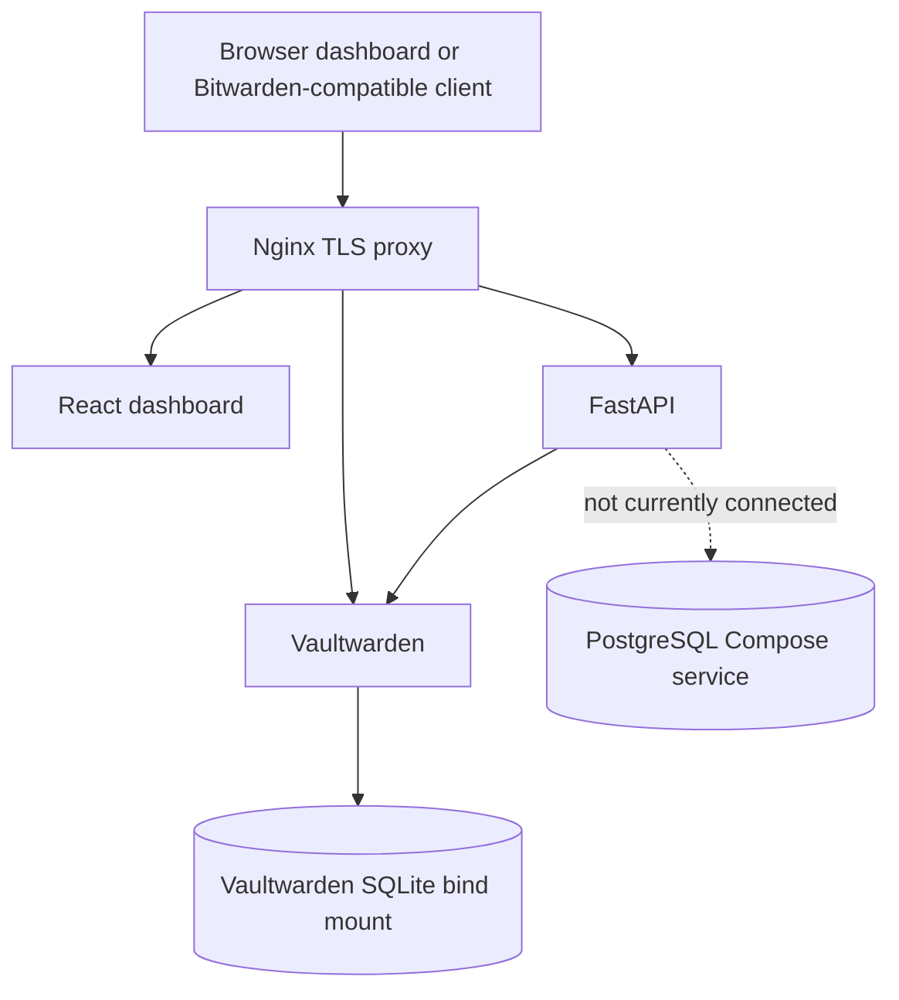

# Architecture Overview

## System Architecture

## Components
- **Vaultwarden**: Bitwarden-compatible vault. Its data is mounted from `vaultwarden/vw-data/` and stored in SQLite.
- **Nginx**: Local TLS reverse proxy. Port 443 serves the dashboard/API; port 9443 serves Vaultwarden.
- **FastAPI**: Feature routers for auth proxying, analysis, breach-list checks, login alerts, generation, and attack estimates.
- **React dashboard**: Logs in through the API, retrieves encrypted vault items, decrypts in the browser, then submits decrypted login fields for analysis.
- **PostgreSQL**: Included as a service but not connected to the backend; login-alert events remain in process memory.

## Data Flow
1. Browser requests enter through Nginx.
2. Vaultwarden login and vault storage use the Vaultwarden service.
3. Dashboard vault analysis decrypts items in the browser and sends the selected decrypted fields to FastAPI.
4. Login-alert events are currently kept in process memory; no analytics persistence is configured.

---

This is a local demonstration architecture, not a production deployment. See [security_model.md](security_model.md) for limitations.
